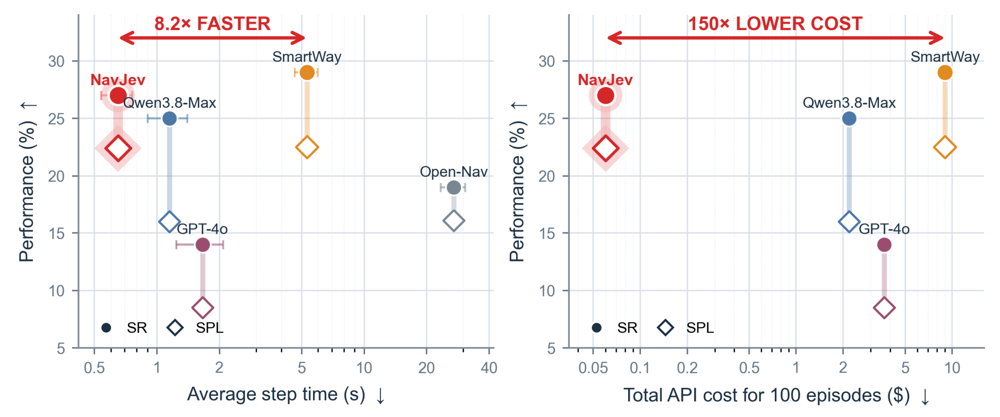
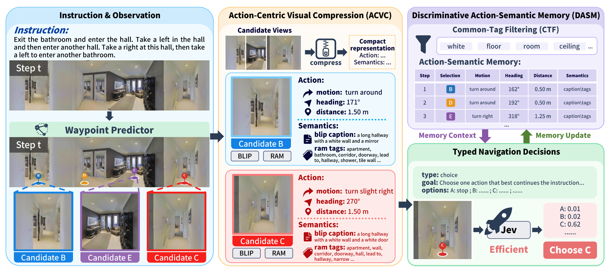
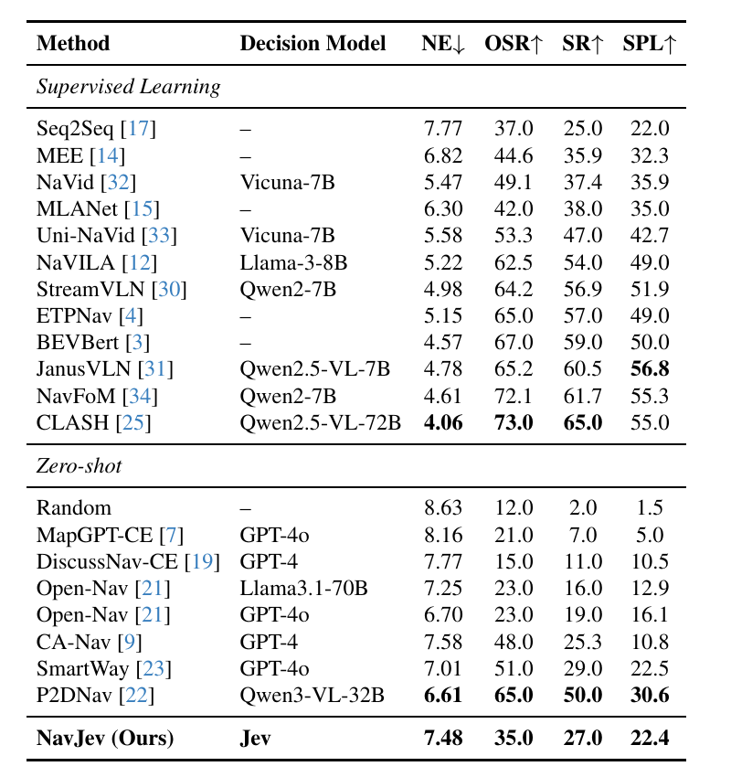
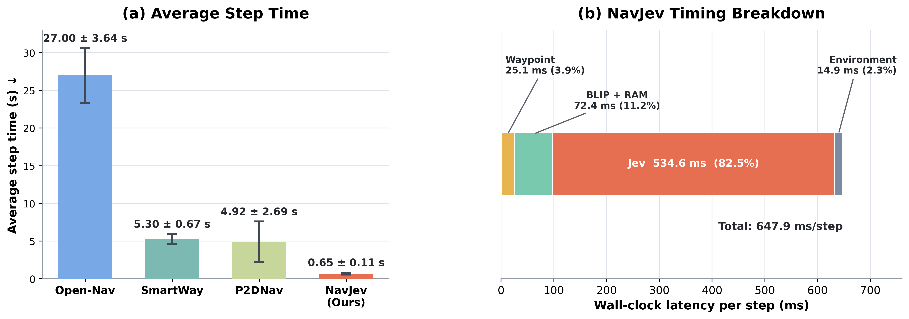
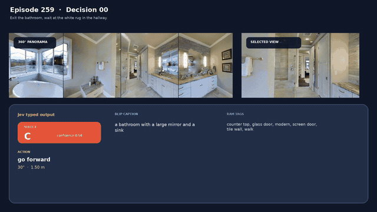
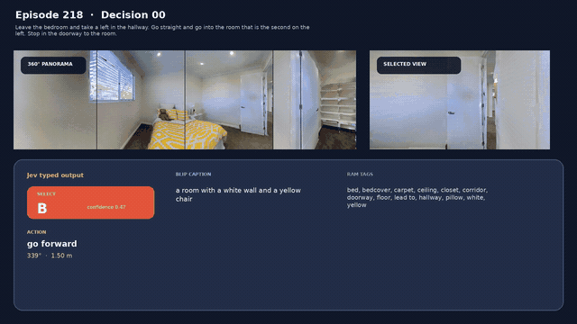

<h1 align="center">NavJev</h1>

<h3 align="center">Efficient Vision-Language Navigation<br>via Action-Centric Visual Compression and Discriminative Action-Semantic Memory</h3>

<p align="center">
  Kai Sheng · Liuyi Wang<sup>†</sup> · Jinlong Li · Haojie Dai · Chengju Liu · Qijun Chen<sup>†</sup>
</p>

<p align="center">
  College of Electronic and Information Engineering, Tongji University<br>
  <sup>†</sup>Corresponding authors
</p>

<p align="center">
  <a href="https://arxiv.org/abs/2609.34969"></a>
  <a href="https://kai-sheng-caesar.github.io/NavJev/"></a>
</p>

<p align="center">
  <a href="#abstract">Abstract</a> ·
  <a href="#method">Method</a> ·
  <a href="#results">Results</a> ·
  <a href="#simulation-demos">Demos</a> ·
  <a href="#setup">Setup</a> ·
  <a href="#citation">Citation</a> ·
  <a href="#acknowledgements">Acknowledgements</a>
</p>

<a id="abstract"></a>

## 📝 Abstract

Recent zero-shot Vision-and-Language Navigation (VLN) methods increasingly rely on multimodal large language models (MLLMs) to reason over visual observations, navigation instructions, and candidate actions. Although effective, repeatedly invoking autoregressive multimodal reasoning at every navigation step introduces substantial inference latency, limiting the responsiveness of embodied agents. We propose **NavJev**, an efficient VLN framework that reformulates online navigation from repeated multimodal generation into compact visual compression followed by lightweight typed action selection. Specifically, **Action-Centric Visual Compression (ACVC)** integrates waypoint geometry, BLIP captions, and RAM semantic tags into compact representations of candidate actions, while **Discriminative Action-Semantic Memory (DASM)** filters shared semantics and maintains discriminative action-specific evidence across navigation steps. Based on these representations, Jev directly performs structured probabilistic decisions over the available action set. Experiments on R2R-CE show that NavJev achieves **27.0% SR** and **22.4% SPL** with only **0.65 s per navigation step**, while substantially reducing inference latency and cost compared with MLLM-based VLN methods.

<p align="center">
  
</p>

<a id="method"></a>

## 🧩 Method

<p align="center">
  
</p>

1. **Action-Centric Visual Compression (ACVC).** A DINOv2-based RGB encoder and a depth encoder support waypoint prediction. For each candidate action, BLIP captions and RAM semantic tags are combined with its motion, heading, and distance, converting visual observations into structured action descriptions.
2. **Discriminative Action-Semantic Memory (DASM).** Common-Tag Filtering separates shared scene semantics from candidate-specific evidence. The executed action and its semantic description are retained in navigation history to support subsequent decisions.
3. **Typed navigation decisions.** Given the instruction, candidate actions, and navigation memory, Jev selects a constrained action label. The selected option maps to an executable waypoint, a backtracking action, or STOP.

<a id="results"></a>

### 📊 Navigation Performance

Navigation performance on R2R-CE, including supervised and zero-shot methods:

<p align="center">
  <a href="assets/results/navigation-performance.png"></a>
</p>

### ⚡ Inference Efficiency

Average navigation step time and the NavJev wall-clock latency breakdown:

<p align="center">
  <a href="assets/results/inference-efficiency.png"></a>
</p>

<a id="simulation-demos"></a>

### 🎬 Simulation Demos

Two successful navigation episodes from our [project page](https://kai-sheng-caesar.github.io/NavJev/). Click either animated preview to watch the full-resolution video.

<table>
  <tr>
    <th align="center" width="50%">Episode 259 · SR 1 · SPL 1.000</th>
    <th align="center" width="50%">Episode 218 · SR 1 · SPL 1.000</th>
  </tr>
  <tr>
    <td align="center"><a href="assets/videos/episode-259.mp4"></a></td>
    <td align="center"><a href="assets/videos/episode-218.mp4"></a></td>
  </tr>
  <tr>
    <td align="center"><a href="assets/videos/episode-259.mp4">▶ Watch full video</a></td>
    <td align="center"><a href="assets/videos/episode-218.mp4">▶ Watch full video</a></td>
  </tr>
</table>

<a id="setup"></a>

## ⚙️ Setup

### 1. Environment

Use Linux with an NVIDIA GPU and a CUDA-compatible driver. Use the following environment:

| Component | Version |
| :--- | :--- |
| Python | 3.10 |
| PyTorch / torchvision | 2.11.0 / 0.26.0, CUDA 12.8 wheels |
| Habitat-Sim | 0.2.4, headless |
| Transformers | 4.46.3 |
| NumPy | 1.26.4 |

From the NavJev repository directory:

```bash
# Create and activate the environment.
conda env create -f environment.yml
conda activate navjev

# Install PyTorch and Python dependencies.
python -m pip install torch==2.11.0 torchvision==0.26.0 \
  --index-url https://download.pytorch.org/whl/cu128
python -m pip install -r requirements.txt

# Prepare the pinned Habitat and RAM source dependencies.
python scripts/setup_dependencies.py
python scripts/setup_dependencies.py --check
```

The setup script prepares the Habitat core, Habitat baseline utilities, and RAM under `third_party/`, using the revisions in [`dependencies.lock.json`](dependencies.lock.json). It also applies the RAM compatibility patch for Transformers 4.46.3.

For detailed background on Habitat installation and navigation dependencies, please refer to the [OpenNav repository](https://github.com/YanyuanQiao/Open-Nav) and [SmartWay repository](https://github.com/sxyxs/SmartWay-Code).

### 2. Dataset

We use the **OpenNav R2R-CE 100-episode subset** and **Matterport3D** scene assets.

**R2R-CE instructions and reference trajectories**

- Download **OpenNav_R2R-CE_100** from [OpenNav's dataset link](https://drive.google.com/file/d/1SfrPWqCIiivwduCYPMe-Za1wOt4eU6G9/view?usp=sharing).
- Prepare the corresponding R2R-CE val-unseen reference trajectories.
- The evaluator uses the local split name `rand100`. Place or symlink the files at the paths below.

```text
data/datasets/
├── R2R_VLNCE_v1-2_preprocessed_BERTidx/
│   └── rand100/
│       └── rand100_bertidx.json.gz
└── R2R_VLNCE_v1-2_preprocessed/
    └── rand100/
        └── rand100_gt.json.gz
```

For example:

```bash
mkdir -p data/datasets/R2R_VLNCE_v1-2_preprocessed_BERTidx/rand100
mkdir -p data/datasets/R2R_VLNCE_v1-2_preprocessed/rand100

cp /path/to/OpenNav_R2R-CE_100_bertidx.json.gz \
  data/datasets/R2R_VLNCE_v1-2_preprocessed_BERTidx/rand100/rand100_bertidx.json.gz
cp /path/to/val_unseen_gt.json.gz \
  data/datasets/R2R_VLNCE_v1-2_preprocessed/rand100/rand100_gt.json.gz
```

**Matterport3D scenes**

Obtain the Habitat scene assets from the [official Matterport3D project page](https://niessner.github.io/Matterport/), then place them under `data/scene_datasets/mp3d/`:

```text
data/scene_datasets/mp3d/
└── <scene_id>/
    ├── <scene_id>.glb
    └── <scene_id>.navmesh
```

Further details are available in [OpenNav](https://github.com/YanyuanQiao/Open-Nav) and [SmartWay](https://github.com/sxyxs/SmartWay-Code).

### 3. Pretrained Weights

Prepare the following models:

| Component | Source | Local path / loading |
| :--- | :--- | :--- |
| TRM waypoint predictor | [SmartWay checkpoints](https://github.com/sxyxs/SmartWay-Code) | `checkpoints/trm_waypoint_predictor.pth` |
| DD-PPO depth encoder | [gibson-2plus-resnet50.pth](https://zenodo.org/record/6634113/files/gibson-2plus-resnet50.pth) | `checkpoints/gibson-2plus-resnet50.pth` |
| RAM | [Recognize Anything](https://github.com/xinyu1205/recognize-anything) | `checkpoints/ram_plus_swin_large_14m.pth` |
| DINOv2 | [DINOv2](https://github.com/facebookresearch/dinov2) | `checkpoints/torch_hub/` and `checkpoints/huggingface/` (automatic download) |
| BLIP | [Salesforce/blip-image-captioning-base](https://huggingface.co/Salesforce/blip-image-captioning-base) | `checkpoints/huggingface/` (automatic download) |

The resulting asset layout is:

```text
NavJev/
├── checkpoints/
│   ├── trm_waypoint_predictor.pth
│   ├── gibson-2plus-resnet50.pth
│   ├── ram_plus_swin_large_14m.pth
│   ├── torch_hub/
│   └── huggingface/
└── data/
    ├── datasets/
    │   ├── R2R_VLNCE_v1-2_preprocessed_BERTidx/rand100/rand100_bertidx.json.gz
    │   └── R2R_VLNCE_v1-2_preprocessed/rand100/rand100_gt.json.gz
    └── scene_datasets/mp3d/<scene_id>/<scene_id>.glb
```

### 4. Run NavJev

Set your Jev API key in `.env`:

```bash
# .env
TYPESAFE_API_KEY=your_api_key
JEV_ENDPOINT=https://api.typesafe.ai/v1/systemone
JEV_MODEL=jev-latest
NAVJEV_CAPTION_MODEL=Salesforce/blip-image-captioning-base
```

Run the default 100-episode evaluation:

```bash
bash eval_jev.sh
```

Use a separate experiment name for an independent run:

```bash
NAVJEV_EXP_NAME=navjev_rand100 bash eval_jev.sh
```

Evaluation results are saved to `logs/eval_results/`.

<a id="citation"></a>

## 📖 Citation

If you find NavJev useful for your research, please consider citing our paper:

```bibtex
@misc{sheng2026navjevefficientvisionlanguagenavigation,
  title         = {NavJev: Efficient Vision-Language Navigation via Action-Centric Visual Compression and Discriminative Action-Semantic Memory},
  author        = {Kai Sheng and Liuyi Wang and Jinlong Li and Haojie Dai and Chengju Liu and Qijun Chen},
  year          = {2026},
  eprint        = {2609.34969},
  archivePrefix = {arXiv},
  primaryClass  = {cs.RO},
  url           = {https://arxiv.org/abs/2609.34969}
}
```

<a id="acknowledgements"></a>

## 🙏 Acknowledgements

We thank [OpenNav](https://github.com/YanyuanQiao/Open-Nav), [SmartWay](https://github.com/sxyxs/SmartWay-Code), [VLN-CE](https://github.com/jacobkrantz/VLN-CE), [Habitat](https://github.com/facebookresearch/habitat-lab), [DINOv2](https://github.com/facebookresearch/dinov2), [Recognize Anything](https://github.com/xinyu1205/recognize-anything), and [BLIP](https://github.com/salesforce/BLIP) for their valuable research, code, models, and datasets.
